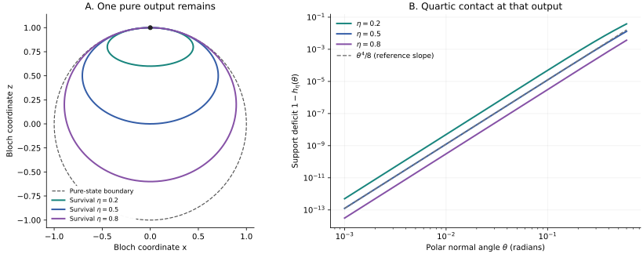

# Quantum Channel Classical Cost

Alice knows a qubit state and sends a classical message. Bob must reproduce measurements on the output of a fixed quantum channel together with an unknown quantum system in his laboratory. **Which noisy qubit channels admit an exact finite message alphabet, and how does the alphabet grow when a small error is allowed?**

The exact answer depends on how the channel's output set meets the pure-state boundary. A qubit channel has a finite exact generic classical simulation if and only if **it has no pure output or is entanglement breaking**. Unlimited input-independent shared randomness does not change this classification. The exact obstruction also rules out every finite public interaction tree.

For amplitude damping with fixed survival probability $`0\lt\eta\lt1`$, the optimal one-way message alphabet and fixed-length bit cost satisfy

```math
M_\eta(\varepsilon)=\Theta_\eta(\varepsilon^{-1/2}),
\qquad
C_\eta(\varepsilon)
=\frac12\log_2\frac1\varepsilon+O_\eta(1).
```

These bounds hold both for uniform measurement-statistics error and for the stronger requirement that the measurement record retain its correlations with an untouched reference. Lower bounds allow arbitrary physical decoders and continuous shared randomness. The matching construction uses a finite menu of pure states and no shared randomness.

| Channel | Exact finite simulation | One-way approximation result |
|---|---|---|
| Every output strictly mixed | Possible | A fixed finite alphabet already works exactly |
| Entanglement-breaking channel | Possible | A finite measure-and-prepare alphabet works exactly |
| Pure output and not entanglement breaking | Impossible | Depends on the channel geometry |
| Amplitude damping, fixed $`0\lt\eta\lt1`$ | Impossible | $`M_\eta(\varepsilon)=\Theta_\eta(\varepsilon^{-1/2})`$ |
| Identity channel | Impossible | $`M_1(\varepsilon)=\Theta(\varepsilon^{-1})`$ |
| Complete reset | Zero bits | Zero bits |

The generic quantum-side-input task, perfect-channel impossibility, and finite depolarizing-channel simulations originate in [Naik, Zartab, Gisin, and Banik](references/RELATED_WORK.md#naik2026). The contribution here is the complete qubit classification and the sharp amplitude-damping accuracy cost, proved through positivity at a pure output and the geometry of its neighborhood.

## Read the science

The [scientific overview](science/README.md) connects the question, proof mechanisms, and consequences. For the complete formal route, start with the [operational model](science/model.md), then the [exact classification](science/exact_classification.md). The [geometry and examples](science/geometry_and_examples.md) connect the exact result to the finite-error law. Its two proof components are the [lower bound with arbitrary shared randomness](science/amplitude_lower.md) and the [finite preparation construction](science/amplitude_upper.md).

| To inspect | Authoritative account |
|---|---|
| Known classical inputs, unknown side inputs, error conventions and resource charges | [Model](science/model.md) |
| Complete exact classification and the finite-random-effect tangent lemma | [Exact classification](science/exact_classification.md) |
| Sharp amplitude-damping theorem, mechanism and endpoint comparison | [Geometry and examples](science/geometry_and_examples.md) |
| Why randomized finite alphabets cannot evade the accuracy lower bound | [Cap-area lower bound](science/amplitude_lower.md) |
| How a nonuniform spherical net supplies the matching protocol | [Preparation upper bound](science/amplitude_upper.md) |
| Inherited results and differences from other simulation resources | [Related work](references/RELATED_WORK.md) and [bibliography](references/references.bib) |
| Reproducible finite checks and their limitations | [Verification](verification/README.md) |



The left panel shows meridian sections of the output ellipsoids. Each nontrivial amplitude-damping channel retains one pure output. The right panel shows the support deficit near that point: it vanishes as the fourth power of the polar normal angle. The [geometric proof](science/amplitude_upper.md) turns this contact into the optimal message-alphabet exponent. The curves are evaluations of the channel's exact support function, not measured communication costs.

## Learn the project

The single educational anchor is John Watrous, *The Theory of Quantum Information* (2018). The [source-to-project bridge](learning/ANCHOR.md) selects the needed sections, translates conventions, and works through a complete two-message example before explaining the new proof mechanisms. Reading the entire book is unnecessary.

The [30-milestone map](learning/MILESTONES.md) follows the scientific story: 12 background milestones assemble the operational framework, and 18 narrative milestones develop the exact classification, matching approximation bounds, and their interpretation. Each milestone records its understanding target, dependencies, conceptual connection, and sources. The map is shared scientific material and contains no personal assessment record.

## Reproduce the finite checks

From the repository root:

```bash
python3 -m pip install -r verification/requirements.txt
python3 verification/verify_science.py
```

The deterministic checks compare independent channel representations, the Bell-effect transpose identity, output eigenvalues, support geometry and reference-state error propagation. They detect normalization and implementation errors; the universal impossibility and asymptotic communication bounds are established by the written proofs. See [verification](verification/README.md) for the tested scope and figure reproduction.

## Scope

The input to Alice is a complete classical description. The theorem concerns a worst-case finite message alphabet with uncharged local computation and input-independent shared randomness. It does not simulate an unknown, reference-entangled channel input. The quantitative law is one-way and holds for each fixed nontrivial damping parameter; no optimal two-parameter crossover or finite expected communication law is asserted. An arbitrary physical decoder is allowed in the converses, even though the upper construction prepares states.

## Purpose and contact

This repository serves as a record of the work and a guide for the author’s self-directed learning. For discussion or potential collaboration, please contact Ruge Lin at [gogoko699@gmail.com](mailto:gogoko699@gmail.com).
