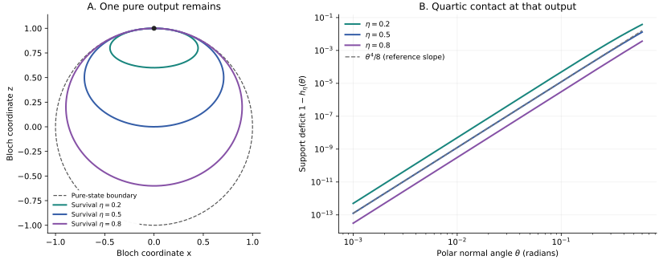

# Output geometry and the cost of accuracy

The [exact classification](exact_classification.md) separates channels whose outputs stay inside the Bloch ball from channels that retain a coherent tangent at a pure output. Amplitude damping supplies a quantitative example of the latter. Its exact communication cost is infinite at every nonzero survival probability, while a finite alphabet suffices for any positive error. The way its output ellipsoid touches the sphere determines the rate of this divergence.

## The sharp amplitude-damping theorem

Use the survival convention

```math
K_0=\begin{pmatrix}1&0\\0&\sqrt\eta\end{pmatrix},
\qquad
K_1=\sqrt{1-\eta}\,|0\rangle\langle1|,
\qquad 0\le\eta\le1.
```

Thus $`\eta=1`$ is the identity and $`\eta=0`$ is complete reset to $`|0\rangle`$. Some literature uses the damping probability $`1-\eta`$ instead.

**Theorem.** For every fixed $`0\lt\eta\lt1`$, there are positive channel-dependent constants and a positive error threshold such that

```math
c_\eta\varepsilon^{-1/2}
\le M_{\mathcal A_\eta}^{\mathrm{stat}}(\varepsilon)
\le M_{\mathcal A_\eta}^{\mathrm{ref}}(\varepsilon)
\le C_\eta\varepsilon^{-1/2}
```

for every error below that threshold. Consequently, for either accuracy convention,

```math
\left\lceil\log_2 M_{\mathcal A_\eta}(\varepsilon)\right\rceil
=\frac12\log_2(1/\varepsilon)+O_\eta(1).
```

The alphabet is uniform over all known input states and all shared seeds. The lower bound already holds for a fixed binary Bell measurement and one unknown side qubit. The upper protocol works for all finite-dimensional side inputs and untouched references. The [model](model.md) defines the two accuracy criteria and every free resource.

The two proofs also give useful, nonoptimal parameter-dependent estimates. For $`0\lt\varepsilon\le1/64`$,

```math
M_{\mathcal A_\eta}^{\mathrm{stat}}(\varepsilon)
\ge\frac{\eta}{256\varepsilon}
\min\left\{\frac14,
\sqrt{\frac{\varepsilon}{\eta(1-\eta)}}\right\}.
```

The [lower-bound proof](amplitude_lower.md) establishes this estimate directly. The [upper-bound proof](amplitude_upper.md) gives a universal constant $`C`$ such that

```math
M_{\mathcal A_\eta}^{\mathrm{ref}}(\varepsilon)
\le \frac{C}{1-\eta}\,\varepsilon^{-1/2}
\qquad (0\lt\varepsilon\le1/4).
```

Only the error exponent for fixed $`\eta`$ is matched. These prefactors do not establish an optimal joint limit in damping and error.

## Why the exponent is one half

The channel acts on Bloch vectors as

```math
(x,y,z)\longmapsto
(\sqrt\eta\,x,\sqrt\eta\,y,1-\eta+\eta z).
```

For pure input $`\sqrt{1-p}|0\rangle+e^{i\phi}\sqrt p|1\rangle`$, its output determinant is

```math
\det\rho_{p,\phi}=\eta(1-\eta)p^2.
```

Near the pure output, the principal output directions fill a cap whose area is proportional to $`p`$, while the smaller eigenvalue is proportional to $`p^2`$. Taking $`p`$ of order $`\sqrt\varepsilon`$ produces a cap of area of order $`\sqrt\varepsilon`$ in which all outputs are within order $`\varepsilon`$ of being pure.

A response effect that carries a nonvanishing amount of the Bell probability can be accurate only on an area of order $`\varepsilon`$ in that cap. Normalizing an effect by its trace is a device inside the proof, not a restriction that Bob prepare a state. Integrating the required positive response weight over the cap forces at least order $`\varepsilon^{-1/2}`$ effects per shared-randomness realization on average. The argument charges the finite menu available at each shared seed, so continuous shared randomness cannot evade it.

For the construction, describe the output set by its support in a direction with polar angle $`\theta`$:

```math
h_\eta(\theta)
=(1-\eta)\cos\theta
+\sqrt{\eta\sin^2\theta+\eta^2\cos^2\theta}.
```

The exact support identity yields

```math
1-h_\eta(\theta)
=\frac{1-\eta}{8\eta}\theta^4+O_\eta(\theta^6).
```

An output depolarization of size order $`\varepsilon`$ opens a support margin of order $`\varepsilon+\theta^4`$. A pure-state vertex at angular distance $`d`$ loses support by order $`d^2`$, so a suitable mesh has spacing of order $`\sqrt\varepsilon`$ in the innermost cap and order $`\theta^2`$ farther away. The cap and dyadic annuli together need order $`\varepsilon^{-1/2}`$ vertices. Support domination proves containment of the complete regularized output ellipsoid, and a convex decomposition gives Alice's message probabilities.

The lower proof uses near-pure directions; the upper proof uses supporting planes. They give the same exponent without assuming that every successful simulator has a state-preparation representation.



The plotted geometry is defined by the formulas above. The [generator](../verification/plot_geometry.py) uses the rationalized deficit to avoid cancellation close to the pole. It does not fit an exponent to simulated protocol costs.

## Endpoints and other channels

At complete reset, Bob prepares a fixed state and no input information is needed. At the identity endpoint, every direction on the sphere remains pure. The same area argument must cover the whole sphere, giving $`\Omega(\varepsilon^{-1})`$ messages; an ordinary spherical net supplies the matching upper bound. Thus

```math
M_{\mathcal A_0}(\varepsilon)=1,
\qquad
M_{\mathcal A_1}(\varepsilon)=\Theta(\varepsilon^{-1}).
```

For every fixed interior parameter, the exponent is one half. The limits $`\varepsilon\to0`$ and $`\eta\to1`$ cannot be interchanged in a statement whose constants depend on $`\eta`$.

Dephasing supplies another exact obstruction. It preserves the two basis states and multiplies coherence by a residual factor $`\kappa`$. Every $`0\lt\kappa\le1`$ has a nonzero tangent at a pure output, so finite exact generic simulation is impossible. Complete dephasing has a two-label measure-and-prepare protocol. No approximate-cost exponent for dephasing is claimed here.

Depolarizing noise gives a different boundary. For $`\mathcal D_v(\rho)=v\rho+(1-v)I/2`$ with $`0\le v\lt1`$, every output lies strictly inside the Bloch ball, so a finite alphabet simulates the channel exactly. This positive branch can contain channels that are not entanglement breaking. For example, the partial transpose of the depolarizing Choi state has an eigenvalue $`(1-3v)/4`$, so $`1/3\lt v\lt1`$ gives a non-entanglement-breaking channel with finite exact cost. This is possible because Alice knows the input description and her encoder may be nonlinear in that description.

More generally, mixing any qubit-channel output with a fixed full-rank state removes all pure outputs. Every positive mixing weight therefore restores finite exact feasibility. This statement gives no uniform alphabet bound as that weight tends to zero. It separates the presence of noise from the particular output geometry that regularizes the communication problem.

## Resource interpretation

The experiment asks for physical composition with Bob's unknown quantum system. Sampling answers to classical measurement descriptions alone is a different task. Conversely, Alice is given a classical state description, so this result is not a simulation theorem for arbitrary unknown or reference-entangled channel inputs.

All protocols here produce an output on every run. Shared randomness has no input information, and no preshared entanglement or quantum communication is available. Local computation and state-preparation precision are uncharged; the construction is an information-theoretic existence result. Its finite menu is global. A decomposition using at most four vertices for one input does not reduce the union of possible message labels to four.

The finite public strategy-tree reduction transfers exact feasibility, but can increase the one-way alphabet enormously. The half-logarithmic bit law therefore makes no claim about optimal interactive communication or finite expected communication with an unbounded message set. These distinctions also separate the result from the channel-capacity and programming problems described in [related work](../references/RELATED_WORK.md).
